# Field Reporting App

A bare **React Native CLI + TypeScript** app for field inspectors who file short reports with photos from sites where the connection is slow, intermittent or absent.

The goal: **deliver every submitted report exactly once, with every image intact and ≤ 5 MiB**, despite force-quits, dropped connections, timeouts and lost responses.

- Reports are written to SQLite **before** the UI says "saved". The app never waits for the network.
- Photos are copied into app-private storage, then resized and compressed one at a time until the file **on disk** is ≤ 5 MiB.
- A UI-independent **upload worker** claims reports with a durable lease, uploads images under deterministic keys, verifies them on the server, then finalizes the report with an **idempotent create-if-absent**.
- **Firebase (Cloud Firestore + Cloud Storage)** is the backend. Its security rules enforce validation, the size limit, idempotency and immutability on the server.
- The **Review** screen reads straight from the server and never shows local queue data.

> **Backend choice.** The brief suggests a small Express backend but lists it as a recommendation, not a fixed requirement. This project uses Firebase and provides the same guarantees: idempotent creation, server-side validation, a finalize step and failure simulation. [Backend](#backend-firebase) maps each requirement to its implementation, and [Known limitations](#known-limitations) lists what Firebase makes harder.

---

## Contents

**The six things the brief asks the README to cover:**

| Brief asks for | Section |
|---|---|
| How to run it | [Prerequisites](#prerequisites) · [Build and run (Android)](#build-and-run-android) |
| How to stand up your backend | [Backend (Firebase)](#backend-firebase) · [Setting up your own project](#setting-up-your-own-project) |
| How to make it fail | [How to make it fail](#how-to-make-it-fail) |
| The decisions you made and why | [Decisions and why](#decisions-and-why) |
| What you'd do with another day | [With another day](#with-another-day) |
| What you knowingly left out | [What I knowingly left out](#what-i-knowingly-left-out) · [Known limitations](#known-limitations) |

**Full contents:**

1. [Requirements status](#requirements-status)
2. [Prerequisites](#prerequisites)
3. [Build and run (Android)](#build-and-run-android)
4. [Backend (Firebase)](#backend-firebase)
5. [Pointing the app at a backend (emulator or physical device)](#pointing-the-app-at-a-backend)
6. [How to make it fail](#how-to-make-it-fail)
7. [Decisions and why](#decisions-and-why)
8. [Architecture](#architecture)
9. [Image pipeline and byte limit](#image-pipeline-and-byte-limit)
10. [Queue, retries, timeouts and idempotency](#queue-retries-timeouts-and-idempotency)
11. [Reset](#reset)
12. [Tests](#tests)
13. [Manual acceptance checklist](#manual-acceptance-checklist)
14. [What I knowingly left out](#what-i-knowingly-left-out)
15. [Known limitations](#known-limitations)
16. [With another day](#with-another-day)

---

## Requirements status

| Requirement | Status |
|---|---|
| React Native CLI (no Expo), TypeScript throughout | ✅ RN 0.88, TS everywhere including the upload pipeline and backend tests |
| Android builds and runs | ✅ Android is the target platform. iOS is optional and untested |
| Upload logic testable without React | ✅ `src/delivery/uploadWorker.ts` has no React or React Native imports. 15 worker tests run in plain Jest |
| Description required, 1–5 photos, camera + gallery | ✅ Checked in the UI (`validateReport`) and again by the server rules |
| Every uploaded image ≤ 5 MB; large photos compressed, not rejected | ✅ Bounded compression steps, measured on disk, enforced again in Storage rules |
| Persist locally before saying "saved" | ✅ Rows and photo copies are committed before the screen closes and before any "Saved on this device" message |
| Resume after reconnect and after reopening | ✅ NetInfo, AppState and launch triggers. Retry times are stored in SQLite |
| No duplicate reports or images on retry | ✅ Client UUID is the document ID, a create-if-absent transaction, deterministic image keys, immutable reports |
| Review fetches from the server only | ✅ `getDocsFromServer`; a fetch error and an empty list are shown differently |
| Deliberate Reset with documented scope | ✅ See [Reset](#reset) |
| README, real incremental Git history, 2–3 min recording | README ✅ · Git history: see the log · Recording: submitted separately |

---

## Prerequisites

- macOS, Linux or Windows with the [React Native environment](https://reactnative.dev/docs/set-up-your-environment) set up for Android
- Node **≥ 22.11** (see `engines` in `package.json`)
- JDK 17 or newer (Android build; the Firebase emulators need Java 11 or newer)
- Android Studio with an emulator (API 24+) or a physical device with USB debugging
- A Firebase project (see [Backend](#backend-firebase))

## Build and run (Android)

```bash
npm install
```

```bash
npm start
```

In a second terminal:

```bash
npm run android
```

To build a release APK:

```bash
cd android && ./gradlew assembleRelease
```

The APK is written to `android/app/build/outputs/apk/release/app-release.apk`.

`npm install` runs `patch-package` automatically, which applies `patches/@nozbe+watermelondb+0.28.0.patch`.

---

## Backend (Firebase)

### What runs where

| Brief's endpoint | Implementation |
|---|---|
| `POST /reports` (create or resolve by idempotency key) | Firestore transaction on `reports/{clientReportId}`: read, and create **only if absent**. Then `getDocFromServer` returns the canonical report |
| `PUT /reports/:id/images/:imageId` | Cloud Storage `putFile` to `reports/{clientReportId}/{imageId}.jpg`. Same key, so a re-upload replaces instead of duplicating |
| Server verifies image receipt and size | `getMetadata` on every object (size and content type) before finalizing. Storage rules reject anything that isn't `image/jpeg` or is over 5 MiB |
| `POST /reports/:id/finalize` | Creating the report document is the finalize step. The rules require 1–5 well-formed image entries whose paths belong to this report |
| `GET /reports` | `getDocsFromServer(query(reports, orderBy(createdAt desc), limit(100)))` |
| `GET /reports/:id` | `getDocFromServer(reports/{id})` (used after finalizing) |
| Unique constraint on the idempotency key | The document ID **is** the client UUID. Rules forbid `update` and `delete`, so a blind overwrite of a finalized report is rejected |
| Durable storage | Firestore and Cloud Storage |

Rules live in [`firebase/firestore.rules`](firebase/firestore.rules) and [`firebase/storage.rules`](firebase/storage.rules), with config in [`firebase.json`](firebase.json) and [`.firebaserc`](.firebaserc).

What the server validates:

- Description is a string with non-blank `trim()` and at most 5000 characters.
- `imageCount` equals `images.size()` and is between 1 and 5.
- Each image is `image/jpeg`, `0 < sizeBytes ≤ 5 * 1024 * 1024`, and its path is `reports/{reportId}/{imageId}.jpg`.
- `clientReportId` equals the document ID, and `createdAt` must be the server's `request.time`.
- In Storage, images under a report can't be replaced once that report document exists. This uses a cross-service `firestore.exists()` check.

### Setting up your own project

1. Create a Firebase project and add an **Android app** with package name `com.fieldreportingapp`.
2. Download `google-services.json` into `android/app/`. A file for the author's project is already committed there.
3. In the console, enable **Cloud Firestore** (production mode) and **Cloud Storage**.
4. Put your project ID in `.firebaserc`, then deploy the rules:

   ```bash
   npx firebase login
   ```

   ```bash
   npm run deploy:rules
   ```

   On the first Storage deploy, the CLI asks to let Storage rules read Firestore, which the cross-service `firestore.exists()` check needs. Accept it.

5. Create the Firestore index if prompted. The Review query only orders by `createdAt`, which uses the automatic single-field index.

There is no login, as the brief requires, so the rules allow unauthenticated reads and creates. Don't put real data in this project. See [Known limitations](#known-limitations).

## Pointing the app at a backend

There is no base URL to configure. React Native Firebase reads the project from `android/app/google-services.json`, so an **emulator and a physical device behave the same**: both talk to the cloud project over the device's own connection.

- **Use a different project:** replace `google-services.json` (and `.firebaserc` for rule deploys), then rebuild with `npm run android`.
- **Local Firebase emulators:** used only by the backend integration tests (`npm run test:backend`). The app is not wired to them; see [With another day](#with-another-day).

---

## How to make it fail

There are two ways: real-world conditions on the device, and a built-in failure simulator for the cases you can't produce on demand (a lost response, a 503, a hang).

### Real-world conditions (no code needed)

| Do this | Expected behaviour |
|---|---|
| Turn on **airplane mode**, then save reports | Saved locally; Outbox shows *Waiting for connection*. Turn it off and they upload by themselves |
| **Force-quit** (swipe away) while *Preparing photos* or *Uploading*, then reopen | Nothing lost. Processing resumes from the kept originals; an interrupted upload is rescheduled immediately |
| **Throttle the network** (emulator: *Extended controls → Cellular → Network type EDGE/GPRS*) | Slow but steady progress; the 30 s inactivity timeout does not fire while bytes are moving |
| Toggle Wi-Fi **mid-upload** | In-flight request is aborted, then retried with the same key when back online |
| Pick a **huge photo** (48 MP, > 5 MB) | Compressed in steps until ≤ 5 MiB, never rejected |
| Deploy **stricter rules** or point at a project **without rules deployed** | `permission` error → *Needs attention*, not retried forever |
| Run `npm run test:backend` | Emulator tests send duplicates, oversize images, blank descriptions, overwrites, and check they're rejected or deduplicated |

### Failure simulation (development only)

Debug builds (`__DEV__`) wrap the real API in [`src/api/failureSimulation.ts`](src/api/failureSimulation.ts). It is **off by default** and **left out of release builds**: the wrapper is only applied when `__DEV__` is true, and the screen is only registered in debug builds.

Open it from **Dashboard → "Dev: failure simulation"** and choose:

| Mode | What it does | What to look for |
|---|---|---|
| Added latency | Waits 1, 3 or 10 s, then performs the real request | Slow 2G-like behaviour; progress keeps moving |
| Drop before request | Throws a network error before anything reaches the server | `Retry scheduled`, backoff of 2 s → 4 s → … |
| **Commit, then lose response** | Performs the real request, then throws as if the response was lost | Retry resolves the existing report: **one** server record |
| Validation error (422) | Rejected as invalid | `Needs attention`, not retried automatically; **Retry now** works |
| Server error (503) | Transient server failure | Retried with backoff |
| Hang until timeout | Never responds | The 30 s inactivity timeout fires, then a retry with the same key |
| Connection refused | Server unreachable | Retried with backoff |

You can also choose **what it applies to** (any request, image upload, finalize, or the Review fetch) and **how many** requests it affects (next 1, next 2, or every request until turned off). "Next 2 requests" on *Image upload* reproduces "drop the connection twice mid-upload".

To check what the server actually stores, use the Firebase console (Firestore → `reports`, Storage → `reports/{id}/`) or the app's Review screen. Each document's `images[].sizeBytes` is the size the server measured.

---

## Decisions and why

| Decision | Why | Trade-off accepted |
|---|---|---|
| **Firebase (Firestore + Storage) instead of an Express server** | No server to host or keep alive for reviewers; security rules give server-side validation and immutability; the emulator suite makes the backend testable in CI | Finalize can't verify Storage objects server-side without a Cloud Function (see [Known limitations](#known-limitations)) |
| **Client-generated UUID is the idempotency key *and* the document ID** | Uniqueness is enforced by the database itself, not by a lookup that could race. A retry after a lost response lands on the same document | The client must never regenerate the ID; it is persisted before the first attempt |
| **Create-if-absent transaction + rules that forbid update/delete** | Makes "commit then lose response" safe: the retry resolves the existing report instead of creating or overwriting one | Reports are immutable; editing would need a new design |
| **Deterministic image keys** (`reports/{uuid}/{imageId}.jpg`) | Re-uploading replaces an object instead of adding a duplicate | An object can be replaced until the report is finalized (then rules freeze it) |
| **SQLite via WatermelonDB as the outbox** | Durable, transactional, observable from React; survives force-quit. Retry times live in the DB, not in memory timers | Native dependency plus a small `patch-package` patch |
| **Upload worker is plain TypeScript behind interfaces** | Testable in Jest without React or a device; the UI only observes state and never owns upload logic | A little more wiring (`deliveryService`) to connect triggers to the worker |
| **Durable lease when claiming a report** | Overlapping triggers (NetInfo + foreground + timer) can't upload the same report twice; an expired lease recovers after a crash | Lease is device-local only, which is fine since a report never leaves its device |
| **Always re-encode to JPEG and step down quality/size, measuring the file on disk** | The limit is about bytes on the wire, so it is checked on the actual file, not estimated. Bounded steps mean predictable CPU on low-end phones | Some quality loss on very large photos; HEIC/PNG are not preserved |
| **5 MB = 5 MiB (5,242,880 bytes)**, defined once and mirrored in the rules | Removes ambiguity; tests check exactly the boundary and one byte over | — |
| **Inactivity timeout (30 s) rather than a total timeout** | A slow 2G upload that keeps moving should not be killed; a hung one should | A very slow trickle could take a long time, but it is visibly progressing |
| **Backoff 2 s → 30 s cap with ±25% jitter; honour `Retry-After` up to 5 min** | Recovers quickly from blips without hammering the server, and avoids thundering-herd retries | — |
| **Validation/permission errors go to *Needs attention*, not retried** | Retrying a request that can never succeed wastes battery and hides a real problem | User must tap **Retry now** after the cause is fixed |
| **Connectivity is a hint, not a gate** | `isInternetReachable` is often wrong; only `isConnected === false` skips an attempt and the request result decides | Occasional wasted attempt on captive networks |
| **Review uses `getDocsFromServer` only** | The brief requires showing what the server has, never the local cache or outbox | Review doesn't work offline (and says so clearly) |
| **"Uploaded" only after the server's canonical response is validated and stored locally** | The UI must never claim delivery it can't prove; the progress bar stops at 95% until then | — |
| **Reset deletes local data only, and warns about un-uploaded reports** | Reset is a device-cleanup tool, not a server admin tool; losing unsent work must be an explicit choice | Abandoned images may remain in Storage |
| **Failure simulator compiled into debug builds only** | Lets reviewers reproduce lost responses, 503s and hangs on demand, without any risk of shipping it | — |

---

## Architecture

```mermaid
flowchart LR
  subgraph UI["UI (React screens)"]
    Compose[Compose<br/>screens/uploadReport]
    Outbox[Dashboard + Outbox<br/>features/outbox]
    Review[Review<br/>features/review]
    Reset[Reset dialog<br/>features/reset]
  end

  subgraph Device["Device services (no React)"]
    Save[saveReportLocally<br/>features/compose]
    Repo[(SQLite via WatermelonDB<br/>data/reportRepository)]
    Files[(App-private files<br/>data/fileStore)]
    Proc[Image processing queue<br/>images/processingQueue + imageProcessor]
    Service[Delivery service<br/>delivery/deliveryService]
    Worker[Upload worker<br/>delivery/uploadWorker]
    Policy[Retry policy + timeouts<br/>delivery/retryPolicy, requestTimeout]
  end

  subgraph API["API client"]
    Sim[Failure simulation<br/>dev only]
    Fb[firebaseReportApi<br/>+ apiErrors normalisation]
  end

  subgraph Server["Firebase"]
    FS[("Firestore reports/&#123;uuid&#125;<br/>rules: validate, create-once")]
    ST[("Storage reports/&#123;uuid&#125;/&#123;imageId&#125;.jpg<br/>rules: jpeg, ≤5 MiB, frozen after finalize")]
  end

  Compose --> Save --> Files & Repo
  Outbox -. observes .-> Repo
  Reset --> Repo & Files
  Service -->|launch / NetInfo / foreground / retry timer| Proc & Worker
  Proc --> Files & Repo
  Worker --> Repo
  Worker --> Policy
  Worker --> Sim --> Fb --> FS & ST
  Review --> Sim
```



| Layer | Files | Notes |
|---|---|---|
| UI | `src/screens/*`, `src/features/{outbox,review,devtools}` | Observes SQLite through `useOutbox()` and owns no upload state |
| Repository | `src/data/reportRepository.ts`, `src/database/*` | Typed state changes. Each multi-row change runs inside one `database.write` (WatermelonDB serializes writers, so each one is a transaction) |
| Image processor | `src/images/imageProcessor.ts` (pure), `nativeImageDeps.ts`, `processingQueue.ts` | One image at a time; native resize runs off the JS thread |
| Upload worker | `src/delivery/uploadWorker.ts` | Pure TypeScript. Depends on the `ReportQueueRepository` and `ReportApi` interfaces in `deliveryTypes.ts` |
| Retry policy | `src/delivery/retryPolicy.ts`, `requestTimeout.ts` | Error classification, backoff with jitter, inactivity timeout |
| API client | `src/api/*` | Maps Firebase errors to typed `ApiErrorCode`s and validates server responses (`serverReport.ts`) |
| Backend | `firebase/*.rules`, `firebase/tests` | Server-side validation and idempotency, tested on the emulators |

### Data model

`reports` (one row per report):

| Column | Meaning |
|---|---|
| `client_report_id` | Stable UUID v4 generated at save time. It is the idempotency key and the Firestore document ID |
| `description` | Required, trimmed text |
| `status` | `preparing` · `queued` · `uploading` · `retry_scheduled` · `uploaded` · `needs_attention` (a typed union in `deliveryTypes.ts`) |
| `created_at`, `updated_at` | Local timestamps (ms) |
| `server_report_id` | Canonical ID returned by the server; set only after the response is validated |
| `image_count` | Expected image count (1–5) |
| `attempt_count` | Total attempts. `consecutive_failures` drives the backoff and resets on success or manual retry |
| `next_attempt_at` | Durable retry time |
| `last_error_code`, `last_error_message` | Typed error code and a message safe to show users |
| `lease_expires_at` | Worker claim expiry |

`report_images` (one row per photo): `image_id` (UUID), `position`, `original_file_name` (copy kept until processing succeeds), `file_name` (processed JPEG), `status` (`processing` · `ready` · `uploaded` · `failed`), `mime_type`, `size` (bytes measured on disk), `width`, `height`, `remote_path`, `remote_url`.

All file paths are stored **relative** to `Documents/pending-uploads/`, never as base64. Schema v2 includes a migration from v1 that keeps existing rows (`src/database/migrations.ts`).

### Outbox states (what the user sees)

| Durable status | Label | Detail |
|---|---|---|
| `preparing` | **Preparing photos** | "Saved on this device · 2 of 5 photos ready" |
| `queued`, online | **Saved locally** | "Saved on this device · waiting to upload" |
| `queued` or `retry_scheduled`, offline | **Waiting for connection** | |
| `uploading` | **Uploading** | "Sending photo 2 of 5 · 40%" → "Checking photo… on the server" → "Waiting for the server to confirm". The bar stops at 95% until the server confirms |
| `retry_scheduled` | **Retry scheduled** | Last error plus a countdown; **Retry now** button |
| `uploaded` | **Uploaded** | Only after the server's canonical response is validated and stored locally; shows the server ID |
| `needs_attention` | **Needs attention** | Explains the error; **Retry now** button |

"Sending … %" counts bytes acknowledged by the Storage SDK for the current image. It does not claim the report is on the server.

---

## Image pipeline and byte limit

**Convention:** 5 MB means **5 MiB = 5 × 1024 × 1024 = 5,242,880 bytes**. An image is valid when `sizeBytes <= 5 * 1024 * 1024`. The value is defined once on the client (`src/delivery/limits.ts`) and repeated in both rule files. The backend tests check exactly 5 MiB (accepted) and 5 MiB + 1 byte (rejected).

1. **Copy.** On save, each picked photo is copied into `pending-uploads/originals/` before the report row is committed, so the queue never depends on a temporary picker URI.
2. **Re-encode.** The processing queue takes one image at a time and always re-encodes it as JPEG. This normalizes HEIC/PNG and caps the dimensions, preserving aspect ratio (`contain`, `onlyScaleDown`).
3. **Step down until it fits.** The steps are `[2560 px, q85] → [2048, q75] → [1600, q65] → [1280, q55] → [1024, q45]`. After each pass the **file on disk** is measured; the next step runs only if it is still over the limit. The first step usually gives 0.5–2 MB, which keeps uploads practical on 2G.
4. **Commit.** The file is moved to `pending-uploads/processed/{imageId}.jpg` and measured again. Only then is the image marked `ready` with its measured size and dimensions. The original is deleted after that commit.
5. **Handle failure.** If processing fails, the report is kept, the image is marked `failed`, and the report moves to `needs_attention` with a clear message. The original stays, so **Retry now** processes it again.
6. **Clean up.** Processed files are deleted only after the server confirmed the report and `uploaded` was committed locally.

Native resize and encode run on a native thread. JavaScript only holds paths, never image bytes.

---

## Queue, retries, timeouts and idempotency

### Persist before sending

`saveReportLocally` copies the photos, then writes the report and image rows in one transaction with a fresh UUID. Only then does the compose screen close. If the device is offline it also says **"Saved on this device — waiting to upload."**; online, the upload starts right away and progress shows in the Outbox. No network call is involved in saving.

### Upload protocol (per report)

1. **Claim.** In one write transaction, the report must be eligible: `queued`, a `retry_scheduled` that is due, or `uploading` with an expired lease. Its status is set to `uploading` and `lease_expires_at` to now + 10 min; `attempt_count` is incremented. A second worker, or an overlapping trigger, finds the lease held and skips the report.
2. For each image not yet confirmed:
   - Upload it to `reports/{uuid}/{imageId}.jpg`, then record `uploaded` and the remote path. This also renews the lease.
   - Verify the stored object's size and type with `getMetadata`. If the object is missing, the image is marked for re-upload and the attempt is retried. If it doesn't match, the report goes to `needs_attention` and the image is re-uploaded on manual retry.
3. **Finalize.** Run the create-if-absent transaction with the **same UUID** on every attempt, then read the canonical document back from the server.
4. **Validate the response.** The ID, image count and image IDs must match, and every size must be ≤ the limit.
5. **Reconcile.** Mark the report `uploaded` with its `server_report_id` in one transaction, **then** delete the local files.

### Delivery guarantee

**Effectively-once report creation:** idempotent server-side effects plus durable client retries.

- A client can't get exactly-once delivery by itself, because the server may commit and the response may still be lost. So every attempt reuses the same key.
- The server keeps the first commit: the transaction never overwrites, and the rules forbid updates. A retry therefore *resolves* the existing report instead of creating a second one.
- Images use deterministic keys, so retries replace an object instead of adding new ones.
- This holds as long as Firestore and Storage behave consistently, which is the backend's normal contract.

### Retry classification

Firebase reports gRPC-style codes, which `src/api/apiErrors.ts` maps onto the brief's HTTP categories:

| Class | Firebase codes (examples) | HTTP equivalent | Handling |
|---|---|---|---|
| `network` | `storage/unknown`, `storage/retry-limit-exceeded`, `storage/canceled`, "Network request failed" | connection reset / unavailable | Retry |
| `timeout` | `firestore/deadline-exceeded`, our inactivity timeout | 408 | Retry with the same key (outcome is ambiguous) |
| `rate_limited` | `firestore/resource-exhausted`, `storage/quota-exceeded` | 429 | Retry; `Retry-After` honoured when present, capped at 5 min |
| `server_unavailable`, `server_error` | `firestore/unavailable`, `aborted`, `internal` | 5xx | Retry |
| `remote_object_missing` | `storage/object-not-found` | — | Re-upload that image, then retry |
| `validation` | `firestore/invalid-argument`, `failed-precondition` | 400 / 413 / 422 | **Needs attention** |
| `permission` | `firestore/permission-denied`, `storage/unauthorized` | 401 / 403 | **Needs attention** (configuration error, never retried forever) |
| `image_too_large`, `local_file_missing`, `verification_failed`, `unexpected_response`, `unknown` | — | — | **Needs attention** |

Note that Firebase rules report a *validation* failure as `permission-denied`. Both lead to **Needs attention**.

### Backoff

`2 s, 4 s, 8 s, 16 s, then 30 s` for each further consecutive failure, with **±25% jitter**. The maximum is 30 s, or up to 37.5 s with jitter. Server `Retry-After` can extend a delay to at most 5 min.

The retry time is stored in `next_attempt_at`. An in-memory timer only wakes the worker; after a restart, due retries run at launch. The backoff resets when a report succeeds and on **Retry now**.

### Timeouts

Each request runs under a **30 s inactivity timeout** (`src/delivery/requestTimeout.ts`). Uploads reset the timer on every progress event, so a slow-but-moving 2G upload survives while a hung request is cancelled. A timeout is treated as ambiguous and retried with the same key. The Review fetch has a 20 s timeout.

### Triggers and concurrency

- **Launch:** recover interrupted work, then process photos, then upload.
- **NetInfo:** going offline aborts the in-flight request; coming back online starts a run.
- **AppState:** returning to the foreground starts a run.
- **Retry timer**, and saving a new report.

Connectivity is only a **hint**. The worker only skips attempts when `isConnected === false`, and `isInternetReachable` is ignored because it can be wrong; the request result decides. Overlapping triggers merge into one run (single-flight), and the durable lease protects each report even if two workers exist.

### Recovery after process death

At launch, any report still marked `uploading` is moved to `retry_scheduled` and made due immediately; no worker can be alive at that point. `preparing` reports resume processing from their kept originals. Files left behind by a crash between a file write and its database commit are deleted if no row references them and they are more than 60 s old.

---

## Reset

**Dashboard → Reset local data** opens a confirmation that shows exactly what will happen.

**What Reset deletes:**
- Every row in the local `reports` and `report_images` tables (the outbox on this device), in one transaction.
- Every file in `pending-uploads/` that no remaining row references. After a successful reset, that is all of them, so no orphaned files are left.

**What Reset never deletes:**
- **Anything on the server.** Uploaded reports stay in Firestore and Storage and keep appearing in **Review**. There is no server delete operation.

**Safeguards:**
- The dialog says how many reports **have not reached the server** and will be **permanently discarded** ("⚠️ 2 reports have NOT reached the server…"). The confirm button names that number ("Discard 2 & reset"). Uploaded reports are described as removed "from this device's outbox only".
- Reset refuses to run while any report is `uploading` or `preparing`. The check runs again *inside* the delete transaction, so a claim can't slip in between. Uploads are paused during the reset and resumed afterwards.
- If the database step fails, nothing was deleted and the user is told so. If file cleanup fails after the rows are gone, the user is told, and the leftover files are removed at the next launch.
- With an empty outbox, Reset says there is nothing to reset.

---

## Tests

```bash
npm test
```

52 unit tests in `src/tests/`, plain Jest with no React components mounted:

- `uploadWorker.test.ts` drives the real worker with an in-memory repository and a fake server that has the same guarantees as Firebase. It covers:
  - happy path, and commit-then-lost-response
  - two drops mid-upload, with backoff 2 s → 4 s and no duplicate image writes
  - already-uploaded images are not re-sent
  - a hanging request times out and is retried with the same key
  - validation errors are not retried; manual retry resets backoff
  - permission errors are surfaced
  - no finalize while an image is missing; a verification mismatch blocks finalize
  - overlapping `run()` calls, and a second worker blocked by the lease
  - force-quit recovery, and one server report per client UUID across three reports with repeated lost responses
  - the offline hint
- `retryPolicy.test.ts`: classification of every code, Firebase code mapping, backoff sequence, jitter bounds, `Retry-After`.
- `imageProcessor.test.ts`: single pass, bounded compression steps, exactly 5 MiB vs one byte over, failure when nothing fits, re-check after the move.
- `outboxStatus.test.ts`: honest labels (only confirmed reports read "Uploaded", the bar never completes early, offline wording).

```bash
npm run test:backend
```

18 backend integration tests (`firebase/tests/rules.test.ts`). They run against the **Firestore and Storage emulators**, started by `firebase emulators:exec`; Java 11 or newer is required. They cover:

- duplicate submissions resolve to one report
- **commit then lost response**: the retry reconciles the existing report and the collection holds exactly one document
- blind overwrite and update of a finalized report are rejected
- blank description, 0 or 6 images, count mismatch, an image over 5 MiB, a foreign path, an ID mismatch, and a client-supplied timestamp are rejected; 5 images are accepted
- exactly 5 MiB is accepted, 5 MiB + 1 byte is rejected, a non-JPEG is rejected
- re-uploading the same key replaces it
- images are frozen after finalize

```bash
npm run typecheck
```

```bash
npm run lint
```

---

## Manual acceptance checklist

Run on an Android device or emulator against a Firebase project with the rules deployed.

**Composition and validation**
- [ ] A blank or whitespace-only description shows "A description is required." and is not saved.
- [ ] With zero photos, "Add at least one photo." is shown and nothing is saved.
- [ ] One photo saves; five photos save.
- [ ] At five photos the add tile disappears and "Maximum of 5 photos reached" is shown. Picking too many from the gallery adds only the remaining slots and says so.
- [ ] Camera and gallery both work; cancelling the picker does nothing.
- [ ] Deny camera → an explanation. Deny with "Don't ask again" → **Open Settings**. Grant it there and return: the camera opens **without restarting**.
- [ ] A large original (> 5 MB, e.g. a 48 MP photo) ends up ≤ 5,242,880 bytes (check `images[].sizeBytes` in Review or the console).

**Offline durability**
- [ ] Turn on airplane mode. Create three reports, one with five camera photos. Each shows "Saved on this device", then *Preparing photos* → *Waiting for connection* in the Outbox.
- [ ] Force-quit (swipe away) and reopen: all three are still in the Outbox with their photos. None reads "Uploaded".

**Delivery and duplicate prevention**
- [ ] Throttle the network (emulator: *Extended controls → Cellular → Network type EDGE/GPRS*), then turn off airplane mode. Reports upload by themselves.
- [ ] Dev tools → *Drop before request* · *Image upload* · *Next 2 requests*: you see *Retry scheduled*, then recovery.
- [ ] Force-quit during *Uploading* and reopen: the report resumes and isn't stuck.
- [ ] Dev tools → *Commit, then lose response* · *Finalize report*: after the retry, Firestore has exactly **one** `reports/{uuid}` document.
- [ ] In the console: each local report has exactly one document, and each image appears once under `reports/{uuid}/` at ≤ 5 MiB.

**Error handling**
- [ ] *Server error (503)* → retried with a growing countdown.
- [ ] *Validation error (422)* · *Every request* → *Needs attention* and no automatic retries. Turn simulation off, tap **Retry now**, and it uploads.
- [ ] *Hang until timeout* → *Uploading* for about 30 s, then *Retry scheduled* (timeout), then success.
- [ ] *Review fetch* · *Connection refused* → Review shows "Could not load server reports… This is a connection problem, not an empty list."

**Review and reset**
- [ ] Review loads on entry; the header refresh button and pull-to-refresh both refetch.
- [ ] Reports still in the Outbox don't appear in Review.
- [ ] With pending reports, Reset warns how many will be discarded and needs confirmation. While uploading, it refuses.
- [ ] After Reset, Review still lists the uploaded reports, and `pending-uploads/` is empty (`adb shell run-as com.fieldreportingapp ls files/pending-uploads/*`).

---

## What I knowingly left out

These were deliberate scope cuts, not oversights:

- **Authentication and per-user data.** The brief says no login, so rules allow unauthenticated reads and creates. Not production-safe.
- **An Express/Node backend.** Replaced by Firebase; see [Decisions and why](#decisions-and-why).
- **A server-side finalize function.** Image existence is checked by the client (`getMetadata`) before finalize; the rules check shape, size and paths. A Cloud Function would close this gap.
- **Background uploads (WorkManager / headless JS).** Uploads run while the app is alive, and resume on launch or foreground. Nothing is lost, but a report may wait until the app is opened.
- **Resumable uploads across restarts.** A dropped upload restarts that image from zero (each image is ≤ 5 MiB, usually 0.5–2 MB).
- **Editing or deleting reports** after submission. Reports are immutable on the server by design.
- **Deleting server data** (from Reset or anywhere else), and cleanup of orphaned Storage objects from discarded reports.
- **Pagination in Review** — it shows the latest 100.
- **iOS testing.** The code is cross-platform but only Android was built and tested.
- **End-to-end UI tests** (Detox/Maestro). Logic is covered by 52 unit tests and 18 backend emulator tests; UI flows are covered by the [manual checklist](#manual-acceptance-checklist).
- **Wiring the app to the local Firebase emulators.** Only the backend tests use them; the app talks to the cloud project.

## Known limitations

- **No background uploads on Android.** Uploads run while the app process is alive: in the foreground, and briefly after backgrounding until Android suspends the process. There is no WorkManager or headless task, so a report saved and then left in the background may not upload until the app is opened again. Nothing is lost; it resumes at launch or foreground. iOS is the same.
- **The finalize check that images exist is done by the client.** Firestore rules can't read Cloud Storage, so the server can't prove at document-creation time that every image object exists. The client verifies each object with `getMetadata` first, and the rules enforce the image list's shape, sizes and paths. Full server-side verification needs a Cloud Function (see below).
- **Open rules, no auth.** Anyone with the app's Firebase config can read and create reports. That fits the brief's "no login" rule, but it isn't production-ready.
- **The lease protects a single device.** The claim uses a local SQLite transaction. Two devices can never share a report, because the UUID is generated per device, and the server-side idempotency would protect it anyway.
- **Server images from abandoned reports remain.** If a report's images were uploaded but the report was discarded by Reset before finalizing, those objects stay in Storage, unreferenced. Reset never deletes server data.
- **Review shows the latest 100 reports** with no pagination.
- **iOS** builds were not tested. The iOS JSI setting is untouched, and gallery and camera rely on the picker's own permission prompts.
- **Firestore SDK offline cache.** It is never used for Review (`getDocsFromServer`) or for confirmation (a transaction plus `getDocFromServer`, both of which require the server).
- **Storage SDK retries:** `setMaxUploadRetryTime` is set to 60 s, so our 30 s inactivity timeout, not the SDK's 10-minute default, decides when a stalled upload is abandoned.

## With another day

- A **Cloud Function** `finalizeReport` that checks every Storage object (existence, size, JPEG magic bytes) before creating the document, so the finalize check no longer relies on the client.
- **WorkManager** (`react-native-background-fetch` or a headless JS task) for opportunistic background retries on Android, documented as best-effort.
- Point the debug app at the **local emulators** (`connectFirestoreEmulator` / `connectStorageEmulator` with `10.0.2.2`), so the whole demo runs offline from the cloud project.
- **Resumable uploads across restarts** by persisting the Storage session URI, so a 4 MB photo on 2G doesn't restart from zero after a drop.
- A small **export** (share sheet) for pending reports before a Reset.
- End-to-end tests (Detox or Maestro) for the airplane-mode and force-quit scenarios.

---

